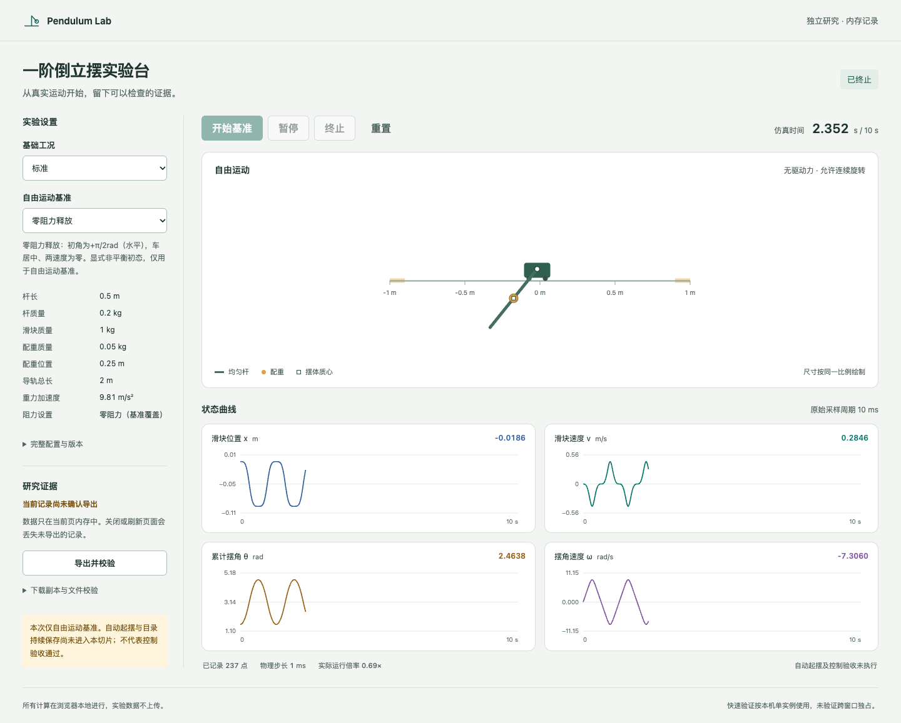

# T01验证与审查记录

本记录是初次实现的历史验证与修复清单，不代表之后完整差异审查没有新发现。最新三项P2的处理见[p2修复记录](p2-fixes/review.md)。

本记录对应[任务#6](https://github.com/guog/pendulum-lab/issues/6)。用户确认的审查基点为185a5a41bb5ec863968a3400271a333003c66f1e；审查命令为`git diff 185a5a4...HEAD`。初版提交c0f864b经两个独立上下文代理分别检查工程规范和规格，修复后逐项复查；不替代人类审查或合并批准。

## 实际验证

- `npm run check`：33项测试（含12项应用会话测试）、格式、Markdown、类型检查与生产构建通过。两项新增审计回归测试在修复前失败、修复后通过。
- `npm run test:browser`：macOS15.8.2/arm64，实际安装Google Chrome156.0.8078.76，独立无头会话，localhost静态预览。可执行文件版本由命令捕获，并核对导出UA的Chrome主版本；UA内的系统版本采用浏览器缩减信息，不用于推断实际宿主OS。
- 真实页面流程覆盖手动暂停/继续/终止/重置、实际切页后台暂停、下载及实际文件读回、错误文件拒绝、十秒静止下垂1001点、1440px与1100px桌面无横向溢出。axe报告0项violation，SVG对比度需人工检查；独立视觉审查确认文字可读。
- 开始请求尚未收到Worker回执时的后台暂停竞态，用受控DOM visibility事件单独回归，保持暂停、200ms内物理时间为0、恢复可见也不自动继续。此项明确是受控事件测试，不冒称真实快速切页时序已复现；另有实际切页用例。

[验证元数据](verification.json)、[实际释放实验导出](release-evidence.json)、[实际平衡实验导出](equilibrium-evidence.json)记录实验身份、配置、原始样本、事件、结果和清单摘要。元数据还给出外层文件SHA-256；内部清单可以独立按UTF-8字节校验。它们来自最终运行，不是手写示例。

## Standards

未发现硬性文档规范违反。发现1项低优先级维护建议：动力学与能量计算重复推导质量、一阶矩及惯量。现统一使用私有massProperties函数；原有轨迹和能量测试通过，审查代理复查为resolved。

本轴共1项建议，已解决；未解决0项。

## Spec

初审发现3项P2，均已修复并由规格审查代理逐项复查：

1. 开始/继续后立即隐藏时，依赖界面缓存状态可能漏发后台暂停。现在隐藏总是发送暂停，Worker自行处理状态。
2. 触边事件缺少四状态和违规条件。初始触边与步内触边现在均独立记录完整状态、条件及轨道边界。
3. 导出缺少对应事件。每次请求记录export事件，stage为requested、persistence_confirmed为false，不新增重复样本、不冒称实际保存成功；Worker快照先于证据回执，导出身份与校验状态随事件同步。

本轴共3项P2，已解决；未解决0项。

## 界面复核与结论边界

界面复核使用独立通用代理承接技能审查包；它检查实际截图和CSS，发现1项键盘焦点轮廓对比度问题。已改为现有accent色，3px轮廓及3px间距；新截图复查对比度超过3:1，单项修复清单得到ship结论。检测器对字号的全16px警告未读取外部CSS，与实际26px标题不符，未据此改变界面。设计系统已从实际代码提取至根DESIGN.md及.impeccable/design.json。

当前结论仅覆盖T01。完整数值物理P0、自动起摆、控制验收、持久化恢复、严格独占和完整性能指标仍未通过本记录验收。原生保存对话框权限/中断没有由本次自动下载流程证明。Windows/Edge与移动设备均未在本次验证。软件尚未发布，Issue关闭或后续任务依赖也不能代替技术验证。

OpenAI Codex实施、测试、整理证据并协调独立代理审查；未代人类批准合并。

Assisted-by: LLM
AI-Agent: OpenAI Codex
